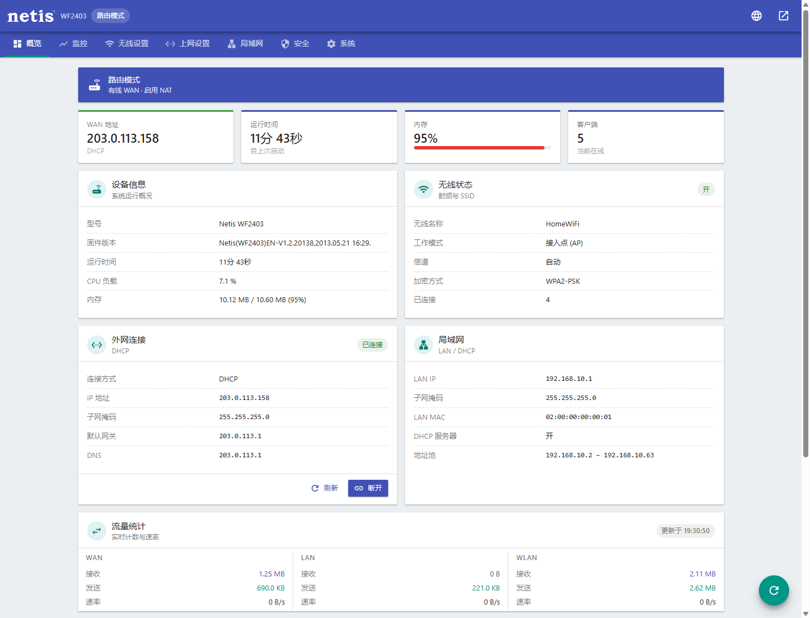
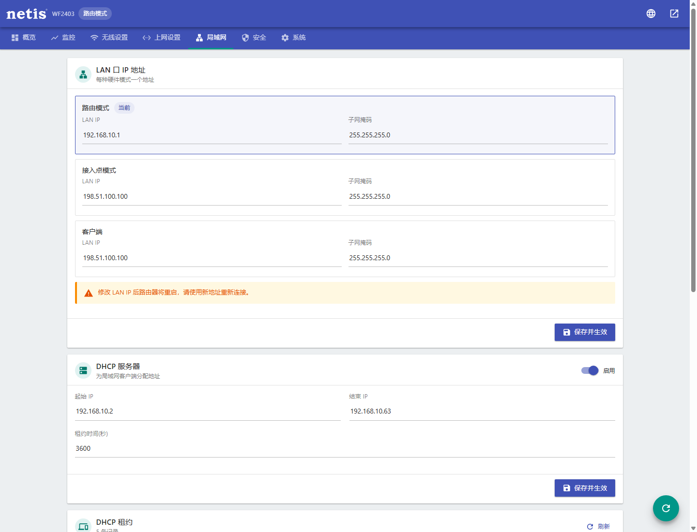
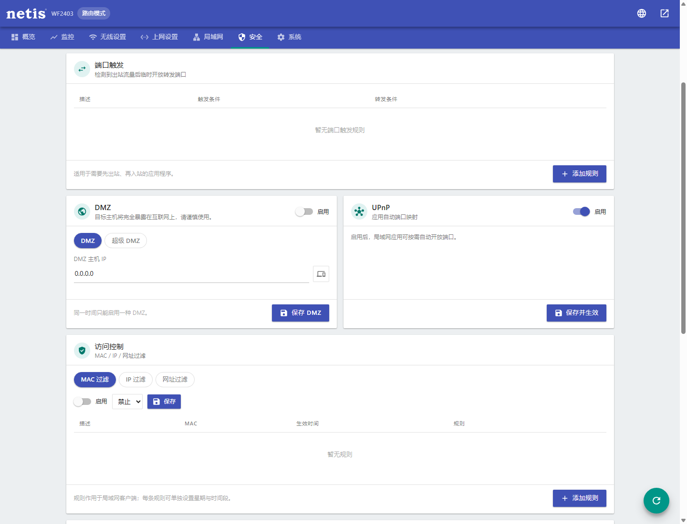
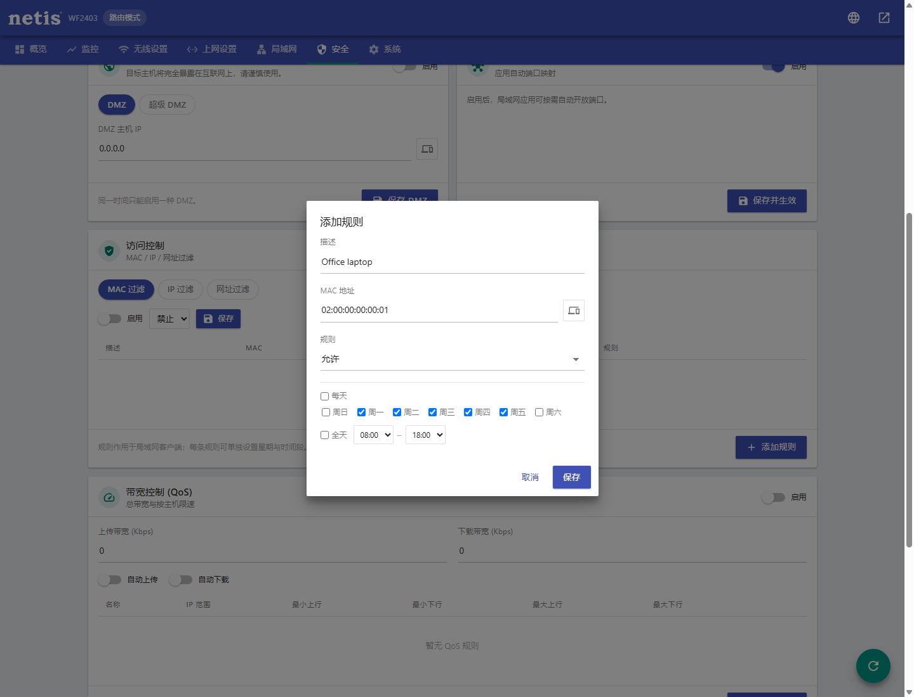

# Netis WF2403 自定义 WebUI 与固件重打包

针对 **Netis WF2403**（Realtek RTL8196C，Linux 2.4.18，SquashFS 2.0）的非官方 Web 控制台与固件打包工具。

> 非官方项目。刷机有风险，请先备份原厂固件并确认设备型号 / 硬件版本一致。

## 效果

| 概览 | 局域网 |
|---|---|
|  |  |

| DMZ | 访问控制 |
|---|---|
|  |  |

## 功能概览

- **单页应用**：8 个主页面，Material Design 1 风格，按运行模式切换主题色
- **概览 / 监控**：CPU、内存、WAN/LAN/WLAN 流量曲线，在线客户端
- **无线**：基本设置（SSID、无线模式 b/g/n、区域、信道、带宽、广播）、安全、WPS、站点扫描、已连主机、高级射频、无线接入控制
- **上网设置**：DHCP / 静态 IP / PPPoE、连接/断开、自动检测、MAC 克隆、DDNS
- **局域网**：三种模式 LAN IP（当前模式高亮）、DHCP 地址池/租期、租约、静态绑定、静态路由
- **客户端 / 中继**：WISP 上游状态、扫描与连接（对齐原厂 `wl_site_surver_connect`）
- **安全**：端口转发（16 种协议预设）、端口触发、DMZ/超级 DMZ 双标签、UPnP、MAC/IP/网址过滤（含星期/时段）、QoS、IGMP/VPN ALG/FTP ALG
- **系统**：时间/NTP、管理员密码、远程管理、固件升级（仅 `.bin`）、重启/恢复出厂、系统日志/连接日志分栏、网络唤醒
- **中英双语**、设备选择浮层、加载遮罩、响应式布局

## 已实现的边界

- 原厂页面保留在 `/index_old.htm`，新控制台为 `/index.htm`
- 原厂固件中没有实际页面的功能（WDS 配置、独立防火墙、LED、TFTP/FTP 升级、Gonnetis、配置备份）未做空壳入口
- 客户端模式代码已按原厂接口对齐，但切模式会改变 LAN 地址，未在远程会话中做实际切换验证
- 原厂页面图片优化（data URI）已回退，保持原厂原始布局；`index_old.htm` 仅保留内存显示修正

## 安全提示：igdmptd 后门

`igdmptd`（`igmptd`）是 Netcore / Netis 系列路由器的已知后门程序（UDP 53413，硬编码 `netcore`，可执行系统命令）。

本项目对固件做了审计：**没有 `/bin/igdmptd`，启动项均为注释，运行时没有 53413 监听**；IGMP 代理由合法的 `igmpproxy` 提供。详见 [docs/SECURITY.md](docs/SECURITY.md)，并可用 `python tools/check_igdmptd.py` 复检。

## 目录结构

```text
squashfs-root/          固件根文件系统（构建输入，含 manifest.json）
  web/index.htm         新控制台（gzip）
  web/index_old.htm     原厂页面（gzip）
  web/index.decompressed.htm   新控制台源码
  web/index_old.decompressed.htm 原厂页面源码
scratch/md1/            构建器
  part_css.css / part_body.html / part_core.js / part_pages.js / part_i18n.js
  assets/               Netis favicon 与 SVG 徽标
  build.py              生成 index.htm 并更新 manifest
  pack_firmware.py      重打包 SquashFS 并组装双块固件
  deploy.py             热部署新控制台（TFTP + telnet bind mount）
  deploy_index.py       热部署原厂页面
  squashfs2_packer.py   SquashFS 2.0 写入器
tests/e2e/harness.py    固件镜像校验工具（打包脚本使用）
tools/check_igdmptd.py  离线检查 igdmptd/igmptd 后门
docs/                   构建、研究、安全、工作记录
firmware/               固件说明与 SHA256（固件本体见 Releases）
screenshots/            UI 截图
```

## 快速开始

```powershell
# 1. 生成新控制台 gzip 与 manifest 尺寸
python scratch\md1\build.py

# 2. 重打包 rootfs 并组装固件
python scratch\md1\pack_firmware.py
```

产物：

- `firmware_backup/web_upgrade_custom.bin`（3,892,322 字节）
- `firmware_backup/mtd1_rootfs_repacked.bin`（3,276,800 字节）

刷机与热部署说明见 [docs/BUILD.md](docs/BUILD.md)。

## 固件发布

见仓库 **Releases**（当前 **v1.0.1**，含 igdmptd / cdrom_wizard 清理）：

- `wf2403-stock-firmware.bin` — 原厂升级镜像
- `wf2403-custom-webui.bin` — 含本项目的自定义 WebUI 固件

两个文件的 SHA256 见 [firmware/SHA256SUMS](firmware/SHA256SUMS)。

## 致谢与工作记录

- 原厂固件逆向、CGI 协议、SquashFS/双块镜像格式：前期 AI 与手动分析
- MD1 SPA、功能对齐、抓包验证、打包流水线：**DeepSeek Harness（deepseek-flash）** 编码代理
- 项目整理、文档编写与发布：**DeepSeek Harness（deepseek-flash）** 与项目维护者
- 原厂 WebUI 素材：Netis 官方站点（favicon / 徽标）

完整过程见 `docs/WORKLOG.md`。

## 许可

未附带开源许可证；如需再分发，请自行确认固件与厂商素材的使用权限。
